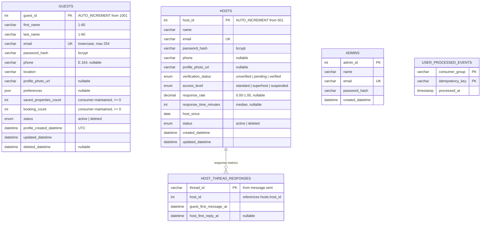

# User service data store

**Owner:** Nathan Pak · **Store:** MySQL (`airbnb_group1` database; the API doc calls this schema `user_db`) and Redis
**Creation script:** [`database/mysql/02_users.sql`](../../database/mysql/02_users.sql) · **Sample data:** `python -m app.seed` (see [service README](../../backend/user-service/README.md))
**Writers:** only `user-service` (API and its consumer worker). Other services read guest/host data through the API or react to `user.registered` / `guest.deleted`.

## Why MySQL

Accounts need what MySQL gives and MongoDB does not by default: a **unique email per role** enforced by the database,
**atomic counter updates** (`saved_properties_count = GREATEST(saved_properties_count + 1, 0)`), and a single
transaction covering a profile change plus the `user_processed_events` row that makes Kafka consumers idempotent.
The data is small, fixed-shape and relational (guest ids are referenced by bookings, messages and reviews), which
matches the project rule to keep users in MySQL. The one flexible field, `preferences`, uses a MySQL `JSON` column
validated by the API, so no second store is needed. Redis holds only short-lived state that can be lost safely.

## Schema diagram

`host_thread_responses.host_id` is a logical reference, not a foreign key, because rows are written from Kafka
events that can arrive before or after related changes. The consumer skips hosts it cannot find.
Guests and hosts are never physically deleted (soft delete), so ids referenced by other services stay valid.

## Indexes and constraints

| Table | Index / constraint | Columns | Serves |
|---|---|---|---|
| guests | PRIMARY | guest_id | `/guests/get`, `/guests/update`, counter updates |
| guests | `uq_guests_email` (unique) | email | signup duplicate check (409), login lookup |
| guests | `ix_guests_name` | last_name, first_name | name lookups and ordering for `/guests/search` |
| guests | `ix_guests_location` | location | location filter for `/guests/search` |
| guests | `ck_guests_counts` (check) | saved_properties_count, booking_count ≥ 0 | counters never go negative |
| hosts | PRIMARY | host_id | `/hosts/get`, `/hosts/update`, metric updates |
| hosts | `uq_hosts_email` (unique) | email | signup duplicate check, login lookup |
| hosts | `ck_hosts_response_rate` (check) | response_rate in 0–1 | valid metric |
| admins | PRIMARY, `uq_admins_email` | admin_id; email | admin login |
| host_thread_responses | PRIMARY | thread_id | one row per guest-initiated thread |
| host_thread_responses | `ix_htr_host_started` | host_id, guest_first_message_at | 30-day window per host for response metrics |
| user_processed_events | PRIMARY | consumer_group, idempotency_key | skip duplicate Kafka events in the same transaction |

Email uniqueness is **per role** (separate tables), so one person may hold a guest and a host account.
Note: `/guests/search` matches names with `LIKE '%q%'`, which cannot use the leading-column B-tree for the
wildcard prefix; at course scale (hundreds of rows) this is a fast scan. A FULLTEXT index is the upgrade path.

## Redis keys

| Key | Value / TTL | Purpose |
|---|---|---|
| `g1:auth:denylist:<jti>` | `1`, TTL = seconds until token expiry | logout and deleted accounts (`shared.auth`) |
| `g1:user:login_fail:<email>` | failure count, TTL 15 min | 5 failed sign-ins per email per 15 minutes → 429 |

If Redis is down, both checks are skipped with a warning so sign-in keeps working.

## Sample rows (from `python -m app.seed`)

`guests`

| guest_id | first_name | last_name | email | phone | location | preferences | saved / bookings | status |
|---|---|---|---|---|---|---|---|---|
| 1003 | Maya | Chen | maya.chen@seed.group1.dev | +14085550101 | San Jose, CA | `{"preferred_locations":["San Jose"],"budget_max":"250.00","amenities":["parking","kitchen"],"property_types":["apartment"],"travel_purpose":"business"}` | 0 / 0 | active |
| 1004 | Liam | Patel | liam.patel@seed.group1.dev | +14085550102 | Sunnyvale, CA | `{"budget_max":"180.00","amenities":["wifi","workspace"],…}` | 0 / 0 | active |
| 1010 | Lucas | Martin | lucas.martin@seed.group1.dev | +14085550108 | Sunnyvale, CA | `NULL` | 0 / 0 | active |

A deleted guest keeps its row: `email = deleted+1001@deleted.invalid`, `phone = NULL`, `preferences = NULL`,
`status = deleted`, `deleted_datetime` set.

`hosts`

| host_id | name | email | verification_status | access_level | response_rate | response_time_minutes | host_since |
|---|---|---|---|---|---|---|---|
| 504 | Daniel Ortiz | daniel.ortiz@seed.group1.dev | verified | superhost | NULL | NULL | 2024-06-10 |
| 506 | Marcus Lee | marcus.lee@seed.group1.dev | pending | standard | NULL | NULL | 2026-07-30 |
| 501 | (after message events) | … | verified | standard | 0.96 | 42 | 2026-11-02 |

`user_processed_events`

| consumer_group | idempotency_key | processed_at |
|---|---|---|
| user-counters | property.saved:2001 | 2026-11-28 01:47:32 |
| user-host-metrics | message.sent:m1 | 2026-11-28 01:47:32 |

Exact ids depend on what already exists in your database; dates shown are examples.
